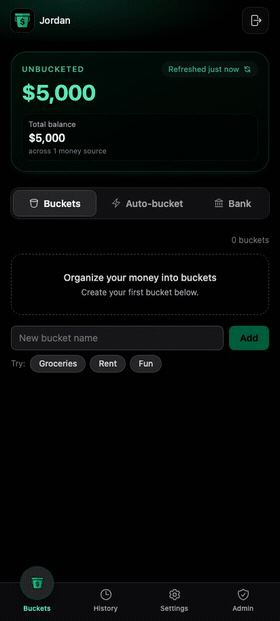
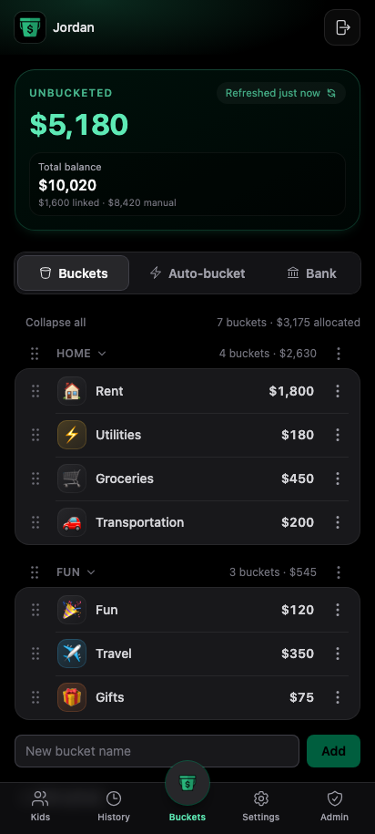
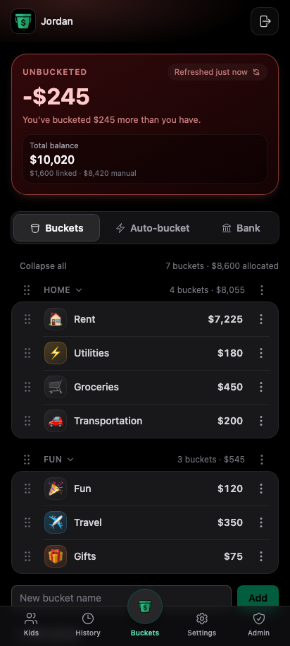
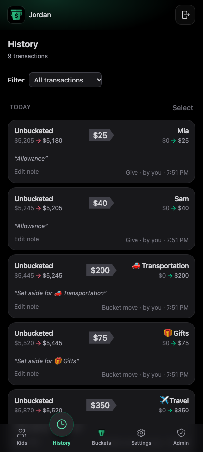
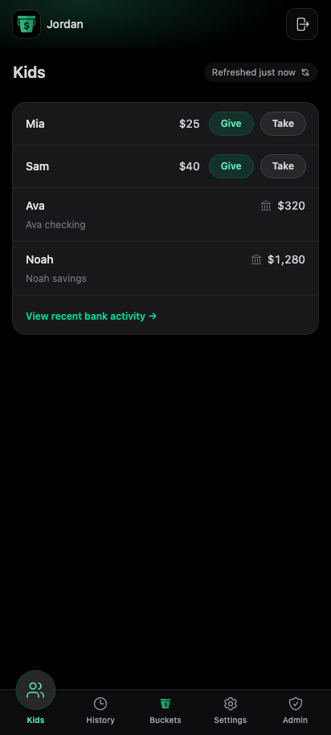

<p align="center">
  <a href="https://bucketmymoney.com">
    
  </a>
</p>

# Bucket My Money

**Live:** [bucketmymoney.com](https://bucketmymoney.com) · App: [app.bucketmymoney.com](https://app.bucketmymoney.com)

Bucket My Money is a progressive web app for organizing cash into **buckets**
— so you know what's actually available, not just what your bank shows. Use it
solo or with a shared household: connect read-only bank accounts and credit
cards, set money aside from **Unbucketed**, and see where your money is at a
glance. Credit cards count against the number — what you see is cash minus card
debt, so a swipe can't hide from your budget. When the balance moves, pick
which bucket covers it.

## Demo

Your bank shows one balance. Buckets show where that money actually is —
create a few, set money aside from **Unbucketed**, and put them in the order that
fits your life.

<p align="center">
  
</p>

## Screenshots

Installable progressive web app with phone-sized UI — Buckets, History, and Kids.
Regenerate after significant UI changes ([docs/MAINTENANCE.md § PWA assets](./docs/MAINTENANCE.md#regenerating-readme--pwa-assets)).

<p align="center">
  
  
</p>
<p align="center">
  
  
</p>

## What it does

- **Unbucketed + buckets** — cash not yet in a bucket lives in **Unbucketed**; buckets
  are money you've set aside. Credit card balances count against Unbucketed, so the
  number is what you really have. The invariant is enforced and derived in Postgres
  (`move_money`, `give_money`, `member_float`).
- **Household roles** — admin, shared member, and kid views with RLS tenant isolation
  and PIN login for members.
- **Move and give money** — set aside from Unbucketed, cover spends, give to kids; History
  with pagination and notes.
- **Read-only bank link** — SimpleFIN Bridge (user-controlled, read-only), manual money sources and card balances for onboarding; provider-swappable design ([docs/BANK_PROVIDERS.md](./docs/BANK_PROVIDERS.md)).
- **Auto-bucket** — scheduled or on-demand rules to set aside into buckets (`pg_cron` on hosted).
- **PWA** — offline fallback, service worker, install screenshots; session-scoped auth.
- **Feature flags** — owner-controlled, per-household flags gate experimental features
  to a single family without shipping them to everyone; read-only in the client, zero
  cost for households without a flag ([docs/FEATURE_FLAGS.md](./docs/FEATURE_FLAGS.md)).
- **Tests** — Vitest unit tests, database RLS/RPC tests, Playwright smoke e2e; CI on every PR.

Product truth and balance model: [CONTEXT.md](./CONTEXT.md).

## Stack

- Vite + React 19 + TypeScript
- Tailwind CSS v4 (CSS-first — see [docs/MAINTENANCE.md](./docs/MAINTENANCE.md))
- `vite-plugin-pwa` (manifest + service worker)
- React Router 7
- Supabase (Auth, Postgres, Realtime, Edge Functions)
- SimpleFIN Bridge (read-only bank connection; Teller quiesced — [docs/BANK_PROVIDERS.md](./docs/BANK_PROVIDERS.md))

## Architecture

```
src/
  components/{ui,layout}/   reusable primitives + app shell
  features/                 auth, buckets, give, kids, history, admin
  lib/                      supabase, auth, buckets, accounts
  hooks/                    shared React hooks
  types/                    DB types (supabase gen types)
  sw.ts                     PWA service worker (injectManifest)
public/
  icons/                    PWA icons
  screenshots/              install UI assets
  demos/                    README demo GIF
supabase/
  migrations/               SQL migrations (sequential numeric prefixes)
  functions/                Deno Edge Functions
```

| Edge Function | Purpose |
| ------------- | ------- |
| `simplefin-claim` | Claim a one-time Setup Token, store the Access URL (service-role only) |
| `simplefin-accounts-confirm` | Import the chosen accounts, classified cash vs card |
| `simplefin-refresh` | On-demand balance re-pull (30-min server throttle) |
| `simplefin-transactions-list` | Recent bank activity window (fetched on demand, not persisted) |
| `simplefin-disconnect` | Remove a connection + its local accounts |
| `simplefin-scheduled-refresh` | pg_cron cadence sweep — keeps balances fresh |
| `teller-*` | Quiesced Teller provider, kept for a possible v2 ([docs/BANK_PROVIDERS.md](./docs/BANK_PROVIDERS.md)) |
| `check-invariant` | Ledger check stub (deferred) |

Balances stay current two ways: the **manual refresh** button (on demand, 30-min
throttle) and the **scheduled sweep** (`simplefin-scheduled-refresh`, every 10 min
via pg_cron) which re-pulls any linked balance older than the cadence
(`SCHEDULED_REFRESH_CADENCE_HOURS`, default 6h) — SimpleFIN has no webhooks, and
its ~24 requests/day budget shapes both. One-time production setup in
[docs/MAINTENANCE.md](./docs/MAINTENANCE.md).

Auth/member functions (PIN login, member management, WebAuthn passkeys) are
omitted here — see `supabase/functions/` for the full list.

## Local development

```bash
npm install
cp .env.example .env.local
npm run db:start          # first time: Docker + local Supabase (~1 min)
source scripts/env-local.sh && npm run dev
```

Open [http://127.0.0.1:5173](http://127.0.0.1:5173). Try demo data: `npm run db:reset:seed -- household`
then sign in as `household@bmm.dev` / `asdfasdf`.

| Command | Purpose |
| ------- | ------- |
| `npm run check:full` | Lint + unit + database tests + production build |
| `npm run test:db` | RLS and money RPC tests (needs `db:start`) |
| `npm run test:e2e` | Playwright smoke (needs `db:start`) |

Full command list, seed scenarios, PWA asset regen, and security checklists:
[docs/MAINTENANCE.md](./docs/MAINTENANCE.md). PR workflow and CI:
[CONTRIBUTING.md](./CONTRIBUTING.md).

## Documentation

| Document | Contents |
| -------- | -------- |
| [CONTEXT.md](./CONTEXT.md) | Product brief, balance model, schema, security |
| [docs/BRAND.md](./docs/BRAND.md) | Voice, Unbucketed terminology, product narrative |
| [docs/AUTO_ORGANIZE.md](./docs/AUTO_ORGANIZE.md) | Auto-bucket feature and cron |
| [docs/FEATURE_FLAGS.md](./docs/FEATURE_FLAGS.md) | Owner-controlled per-household feature flags |
| [CONTRIBUTING.md](./CONTRIBUTING.md) | Branch/PR workflow, CI, deploy sequence |
| [AGENTS.md](./AGENTS.md) | Entry point for AI coding agents |
| [docs/MAINTENANCE.md](./docs/MAINTENANCE.md) | Dev commands, seeds, TODOs, Teller/prod ops |

## License

Proprietary — all rights reserved. Side project / portfolio piece; not open
source. See [LICENSE](./LICENSE).
